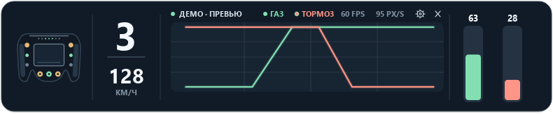

# ACC Trace

Компактный оверлей телеметрии для Assetto Corsa Competizione на Windows. Показывает историю газа и тормоза, положение руля, скорость и передачу. Работает поверх обычных окон и игры в оконном режиме или режиме без рамки.



[Окно настроек](docs/settings.png) · [Назначение осей](docs/settings-axes.png)

В настройках доступны три нарисованных в одном стиле руля: [штурвал](docs/overlay.png), [руль](docs/preview-sport.png) и [классический руль](docs/preview-classic.png). [Подсказки и кнопки снизу](docs/preview-bottom-en.png) · [настройки на английском](docs/preview-settings-en.png).

## Запуск

```powershell
py -m venv .venv
.\.venv\Scripts\python.exe -m pip install -r requirements.txt
.\.venv\Scripts\python.exe -m acc_trace
```

После установки можно запускать двойным щелчком по `start.bat` — приложение откроется без окна консоли.

Для просмотра интерфейса без запущенной ACC:

```powershell
.\.venv\Scripts\python.exe -m acc_trace --demo
```

Запустите ACC и выйдите на трассу. Оверлей автоматически ищет `Local\acpmf_physics` и подключается при появлении данных. Если в ACC есть переключатель Shared Memory, включите его. При запуске панель не активирует своё окно и не забирает фокус у игры. Панель можно перетаскивать мышью; шестерня открывает настройки, крестик закрывает приложение. Строку с подсказками и этими кнопками можно расположить сверху или снизу. Правый щелчок по панели или значок в системном трее также открывают меню с настройками и выходом.

## Настройки по умолчанию

| Параметр | Значение |
| --- | --- |
| Источник | Телеметрия ACC |
| Частота опроса и предел FPS | 60 Гц / 60 FPS |
| Скорость графика | 95 px/s |
| Раздвигать линии при совпадении | Выключено |
| Сглаживание | 65 мс |
| Непрозрачность | 94% |
| Поворот значка руля | 540° от упора до упора |
| Вид руля | Штурвал |
| Подсказки и кнопки | Сверху |
| Язык | Русский (доступен английский) |
| Газ / тормоз / руль | Оси 2 / 3 / 0 (только режим контроллера) |
| Инверсия | Выключена для всех осей |
| Руль / скорость / передача | Показаны |

В режиме **Телеметрия ACC** приложение не обращается к рулю, в том числе при открытии настроек. В режиме **Руль / геймпад** педали и руль считываются через Windows WinMM без захвата устройства и команд обратной связи; скорость и передача продолжают читаться из ACC. Доступны оси X, Y, Z, R, U и V. После обновления проверьте назначение осей и инверсию: нумерация WinMM может отличаться от прежней нумерации SDL и у разных рулей она различается. Демо-режим генерирует данные для проверки внешнего вида.

`steerAngle` в ACC нормализован от −1 до 1, поэтому угол поворота значка можно подстроить в настройках под виртуальный руль конкретного автомобиля. Значение 540° означает ±270° от центра.

Настройки сохраняются в `%APPDATA%\ACC Trace\settings.json`. Частота опроса и отрисовка используют один таймер; фактическая частота может немного снижаться при нагрузке на систему. В эксклюзивном полноэкранном режиме Windows может не показывать поверх игры обычные окна: выберите в ACC режим без рамки.

Проверка отрисовки: `.\.venv\Scripts\python.exe -m unittest discover -s tests -v`.

## Источник формата данных

Первые поля страницы физики соответствуют [документации ACC Shared Memory v1.8.12](https://github.com/SolusDev-sys/CppAccSharedMemory/blob/main/ACCSharedMemoryDocumentationV1.8.12.pdf) и [примеру Physics.cs](https://github.com/heikowulf/ACCsharedmemory/blob/master/Physics.cs).
