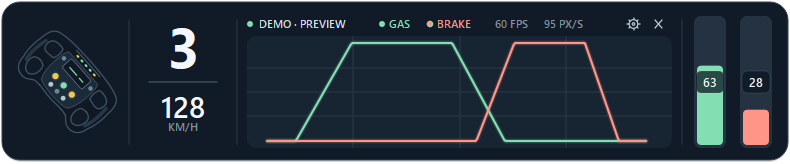
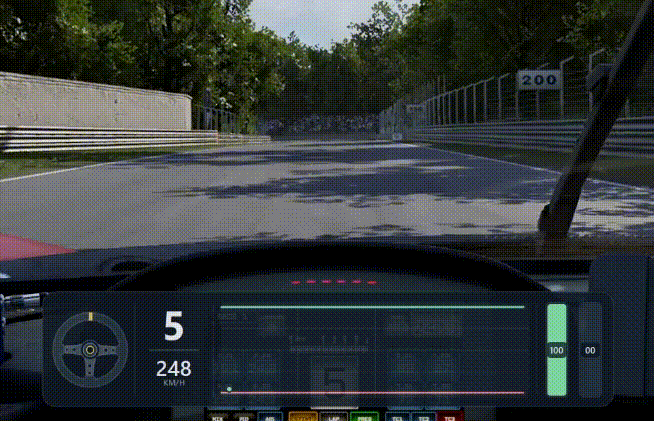
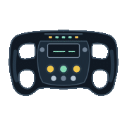
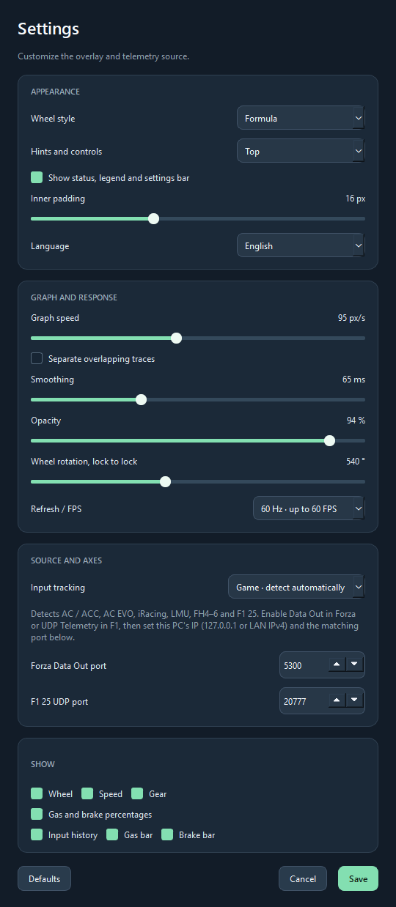

# ACC Trace

**See your racing inputs at a glance.** ACC Trace is a free, compact telemetry overlay for Windows. It shows a live throttle and brake history, steering input, speed, and gear. Use it while driving or add it to an OBS recording or stream.

<p align="center">
  
</p>

## Example of use in ACC

<p align="center">
  
</p>

The overlay works over windowed and borderless games. You can drag it into place, choose which elements to show, and switch between three wheel designs. Unwanted data can be hidden, for instance, you could keep only a minimalist input history graph to help you learn trail braking.

**Three wheel presets in the same style**

<p align="center">
   
</p>

## Download for Windows

[Download the latest portable Windows ZIP](https://github.com/anatolii-me/free_racing_input_telemetry/releases/latest/download/ACC-Trace-Windows-Portable.zip). **Extract** the contents of the archive to your preferred folder, then run `ACC-Trace.exe`. **Keep** the `_internal` folder beside the EXE.

**Settings** are saved as `settings.json` beside the EXE. To update, quit ACC Trace from the system tray and extract the new ZIP into the same folder, **keeping** `settings.json`.

The portable EXE is currently unsigned, so Windows may show a SmartScreen warning on first launch. Check that the ZIP came from this repository's Releases page before deciding whether to run it.

## Run from source

1. Install [Python for Windows](https://www.python.org/downloads/windows/) if you doтn't have it.
2. In this project folder, run:

   ```powershell
   py -m venv .venv
   .\.venv\Scripts\python.exe -m pip install -r requirements.txt
   .\.venv\Scripts\python.exe -m acc_trace
   ```

3. Once setup is complete, you can launch ACC Trace with `start.bat` instead of a console.

Open **Settings** with the gear icon, set **Language** to **English**, and choose an input source. The default is **Game: detect automatically**. Start a supported game and drive onto the track.

Want to preview the overlay without a game? Run `.\.venv\Scripts\python.exe -m acc_trace --demo`.

## Game compatibility

**Verified, works** means tested with a live game. **Expected to work, not tested in game** means the adapter has been checked with sample data or local packets, but has not yet been confirmed in a live session. **Compatibility not added** means there is no game telemetry adapter yet.

For any game without an adapter, **Device** mode can still show throttle, brake, and steering from a wheel or gamepad that Windows exposes through WinMM. Speed and gear need supported game telemetry, they are unavailable in Device mode.

| Game | Game telemetry status |
| --- | --- |
| Assetto Corsa | **Verified, works** |
| Assetto Corsa Competizione | **Verified, works** |
| F1 25 | **Verified, works** |
| Forza Horizon 6 | **Verified, works** |
| Assetto Corsa EVO | **Expected to work, not tested in game** |
| iRacing | **Expected to work, not tested in game** |
| Le Mans Ultimate | **Expected to work, not tested in game** |
| Forza Horizon 4 and 5 | **Expected to work, not tested in game** |
| DiRT Rally 2.0 | **Compatibility not added yet** |
| EA SPORTS WRC | **Compatibility not added yet** |
| Automobilista 2 | **Compatibility not added yet** |
| BeamNG.drive | **Compatibility not added yet** |
| rFactor 2 and RaceRoom Racing Experience | **Compatibility not added yet** |
| Forza Motorsport and F1 24 | **Compatibility not added yet** |

### Where the data comes from

| Input source | Throttle, brake, steering | Speed and gear |
| --- | --- | --- |
| **Game** (default) | From the detected game's telemetry | From the detected game's telemetry |
| **Device** | Directly from a Windows wheel or gamepad | Unavailable |
| **Demo** | Generated sample data | Generated sample data |

You can show or hide the throttle, brake, steering, speed, and gear displays independently. This changes the layout, not the source of the data. The current app does not combine game speed and gear with device axes in one session.

### Game setup

- **AC, ACC, AC EVO, iRacing, and Le Mans Ultimate:** use **Game** mode. If the game has a shared memory option, enable it. ACC Trace looks for a running game automatically.
- **Forza Horizon 4–6:** enable **Data Out** in the game and select **Car Dash** format if offered. Set the destination IP to `127.0.0.1` (or this PC's LAN IPv4 address) and port `5300`.
- **F1 25:** enable **UDP Telemetry**. Set the destination IP to `127.0.0.1` (or this PC's LAN IPv4 address) and port `20777`. ACC Trace accepts the 2025 and 2026 Season Pack packet formats.

If you change a UDP port in ACC Trace, use the same port in the game. If Forza does not send to `127.0.0.1`, try the PC's LAN IPv4 address.

## Settings, in plain English

<p align="center">
  
</p>

| Setting | What it changes |
| --- | --- |
| **Input tracking** | Choose automatic game telemetry, a wheel/gamepad, or generated demo data. |
| **Wheel style** | Choose Formula, Sport wheel, or Classic wheel. |
| **Wheel rotation, lock to lock** | Match the on-screen wheel movement to your car's steering range. For example, 540° means 270° each way from center. This value should match the value in your driver and/or game. |
| **Graph speed** | Set how quickly the input history moves across the overlay. |
| **Smoothing** | Soften sudden changes in the throttle and brake traces. Lower values respond faster. |
| **Separate overlapping traces** | Move matching throttle and brake lines slightly apart so both remain visible. |
| **Refresh / FPS** | Set how often inputs are read and the overlay is redrawn. |
| **Opacity** | Make the whole overlay more or less transparent. |
| **Inner padding** | Adjust the space between the content and the panel edge. |
| **Hints and controls** | Put the status, legend, and buttons at the top or bottom. The nearby checkbox hides this bar until you hover over it. |
| **Show** | Hide individual bars, input history, wheel, speed, gear, or pedal percentages. The panel resizes to fit. |
| **Forza / F1 port** | Match the UDP port set in that game. These fields appear in Game mode. |

In **Device** mode, choose a wheel or gamepad and assign the **Gas**, **Brake**, and **Wheel** axes. Click **Detect**, then move only that pedal or wheel. Use **Invert** if the value moves backward. Device availability depends on what Windows exposes through WinMM. [View the Device settings screen](docs/settings-device-en.png).

## Capture in OBS Studio

1. Add **Window Capture** and select the `ACC Trace` window. When started with `start.bat`, the process may appear as `pythonw.exe`.
2. Set the capture method to **Windows Graphics Capture (WGC)**. Automatic capture may choose BitBlt, which can show a black rectangle instead of the transparent overlay.
3. Place the ACC Trace source above the game source. Check the OBS preview and make a short test recording.

If Window Capture still fails, use **Display Capture** for the screen showing both the game and overlay. Ordinary overlays may not appear over exclusive fullscreen games, so use windowed or borderless mode. After updating ACC Trace, close the old instance from the system tray and refresh the window selection in OBS.

## Notes

- Source launches store settings in `%APPDATA%\ACC Trace\settings.json`; portable launches use the file beside the EXE.
- Right-click the overlay or use its system tray icon to open Settings or quit.
- Device mode only reads input. It does not take control of the wheel or change force feedback.
- Run the tests with `.\.venv\Scripts\python.exe -m unittest discover -s tests -v`.

The game adapters use the games' shared memory or UDP telemetry formats. See the [AC shared memory reference](https://labs.assettocorsa.jp/documents/reference/shared_memory), [ACC shared memory documentation](https://github.com/SolusDev-sys/CppAccSharedMemory/blob/main/ACCSharedMemoryDocumentationV1.8.12.pdf), [AC EVO mapping notes](https://github.com/albertowd/live-telemetry-evo/blob/develop/docs/SHARED_MEMORY.md), [iRacing SDK definitions](https://github.com/meltingice/node-iracing/blob/master/lib/irsdk_defines.h), [Forza Horizon Car Dash layout](https://github.com/shoal-rat/Horizon_FSD/blob/master/docs/telemetry_format.md), [LMU shared memory structures](https://github.com/TinyPedal/pyLMUSharedMemory/blob/master/lmu_data.py), and [F1 25 packet specification](https://forums.ea.com/t5/s/tghpe58374/attachments/tghpe58374/f1-games-game-info-hub-en/61/4/Data%20Output%20from%20F1%2025%20v3.pdf).

To make a new portable ZIP on Windows, install `requirements.txt` and `requirements-build.txt` into `.venv`, then run `packaging\build_portable.ps1`. The archive appears in `dist`.
